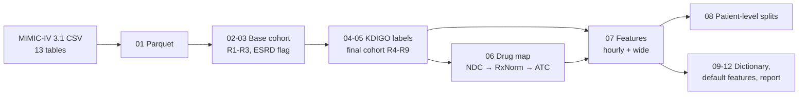

# MIMIC-IV AKI Preprocessing Pipeline

A reproducible preprocessing pipeline that turns raw MIMIC-IV 3.1 tables into a model-ready dataset for predicting acute kidney injury (AKI) in the ICU.

<details>
<summary><b>한국어 요약 (클릭해서 펼치기)</b></summary>

<br>

**배경.** 2026년 10월 16~18일 Korea Clinical Datathon에 참가했다. 팀 주제는 "급성 신손상 예측 모델 개발: AI 에이전트가 예측 성능을 향상시킬 수 있을까?"였고, 데이터는 MIMIC-IV를 사용했다. 나는 팀에서 **전처리**를 맡았다. 이 저장소에는 내가 담당한 전처리 파이프라인만 있다.

**작업.** 파이프라인은 혼자 작성했으며, Ollama로 실행한 로컬 LLM을 코딩 보조로 사용했다. 예측 시점과 예측 구간 같은 일부 정의는 팀의 임상 구성원의 요청을 따랐다.

**과제.** ICU 입실 후 첫 48시간의 데이터로 이후 24시간 안에 AKI(KDIGO 기준)가 시작하는지 예측한다.

**결과 데이터 세트.**
- ICU 입실 94,458건에서 규칙 9개(R1~R9)를 거쳐 11,000건(환자 10,211명)이 남았다. 라벨 1은 1,733건(15.8%)이다.
- hourly 테이블(528,000행, 89칼럼; 시퀀스 모델용)과 wide 테이블(11,000행, 350칼럼; 표 형식 모델용)을 만든다.

**주요 설계.**
- **라벨:** 크레아티닌 기준(48시간 내 0.3 mg/dL 상승, 7일 내 1.5배)과 소변량 기준(6시간 동안 0.5 mL/kg/h 미만)을 구현했다. 소변량은 기록 간격 조건을 두고, 기록이 없는 시간을 0으로 보지 않는다.
- **누수 방지:** 측정 시각뿐 아니라 저장 시각(`storetime`)도 time zero 이전이어야 사용한다. 퇴원 시 부여되는 ICD 코드와 결과 칼럼은 모델 입력에서 제외하도록 표시했다.
- **결측:** 대치하지 않는다. 관측 마스크(`_obs`)와 마지막 측정 후 경과 시간(`_hsl`)을 함께 제공한다.
- **약물:** NDC → RxNorm → ATC로 처방을 분류하고, 투여 경로에 맞지 않는 분류는 제거한다.
- **분할:** 환자 단위의 무작위, 연도별, 혼합 분할 세 가지를 제공한다.
- **재현성과 점검:** 모든 매개변수는 `config.yaml`에 있다. 깨끗한 복사본에서 02~12단계를 다시 실행해 같은 결과를 확인했다. 노트북에서 셔플 라벨 대조군과 기록 빈도 점검으로 데이터를 확인한다.

**문서.** 모든 문서에 국문본이 있다. [docs/index_kr.md](docs/index_kr.md)에서 시작하면 된다. 전체 보고서는 [PREPROCESSING_REPORT.md](PREPROCESSING_REPORT.md)의 후반부(한국어)에 있다.

**데이터.** 이 저장소에는 코드만 있고 MIMIC-IV 데이터나 파생 데이터는 없다.

</details>

## Context

I took part in the **Korea Clinical Datathon** on October 16–18, 2026. Our team worked on the topic *"AKI prediction model development: Can an AI agent improve prediction performance?"* using **MIMIC-IV**. I was responsible for **data preprocessing**.

This repository contains only that part: the pipeline that builds the dataset. The team's modeling and AI-agent experiments are not included.

I wrote the pipeline by myself, using a local LLM run through Ollama as a coding assistant. Some definitions, such as the prediction time and the prediction window, follow requests from the clinicians on the team.

## Task

| | |
| --- | --- |
| Unit | One ICU stay (`stay_id`) |
| Input | Data from the first 48 hours after ICU admission |
| Prediction time (time zero) | ICU admission + 48 hours |
| Outcome | First AKI (KDIGO) starts within the 24 hours after time zero |

## Pipeline



Twelve numbered scripts run in order (`scripts/run_all.sh`). Each script reads the files of earlier steps, checks its inputs, and writes its own outputs. All parameters are in [`config.yaml`](config.yaml).

## Resulting dataset

| Item | Value |
| --- | --- |
| ICU stays in MIMIC-IV 3.1 | 94,458 (65,366 patients) |
| ICU stays in the dataset | 11,000 (10,211 patients) |
| Label 1 | 1,733 stays (15.8%) |
| Label 1 by creatinine / urine output / both | 778 / 1,092 / 137 |
| Hourly table | 528,000 rows (11,000 stays × 48 hours), 89 columns |
| Wide table | 11,000 rows, 350 columns |

The largest selection steps are the 48-hour minimum ICU stay (R3) and the exclusion of AKI before time zero (R6). The full cohort flow is in [docs/preprocessing_notes.md](docs/preprocessing_notes.md).

## Design highlights

- **KDIGO labels from raw data.** Creatinine criteria (≥0.3 mg/dL within 48 h; ≥1.5× the lowest earlier value within 7 days) use pre-ICU laboratory values, joined by `subject_id`. The urine criterion (<0.5 mL/kg/h over 6 h) requires documented intervals of at most 2 hours, and a missing record never counts as zero output.
- **Leakage control.** A measurement is used only if both its charting time and its storage time (`storetime`) are before time zero. Infusions are cut at time zero. ICD codes assigned at discharge and all outcome columns are marked as non-inputs, and `default_features.json` lists the suggested inputs.
- **No imputation.** Missing values stay missing. Each hourly variable has an observation mask (`_obs`) and hours since the last value (`_hsl`). Implausible values are set to missing and counted.
- **Drug features.** Prescriptions are mapped NDC → RxNorm → ingredient → ATC through the NLM RxNav service, with a name-based fallback and a route filter. 79.7% of the orders that start before time zero receive an ATC class.
- **Splits.** Random, temporal and hybrid splits, all by patient.
- **Reproducibility.** A re-run of steps 02–12 in a clean copy of the project gave identical outputs (`scripts/compare_runs.py`).
- **Sanity checks.** [`notebooks/baseline_models.ipynb`](notebooks/baseline_models.ipynb) checks that the data can support a model: a shuffled-label control, feature importance, and a check that charting-frequency features do not explain the signal on their own.

## Repository layout

```text
config.yaml                 all cohort, label, feature and split parameters
scripts/                    pipeline steps 00-12, run_all.sh, compare_runs.py, make_share_zip.py
docs/                       definitions, feature dictionary, itemids, pipeline, notes (English + _kr Korean)
notebooks/                  baseline_models.ipynb (dataset sanity check, no outputs stored)
PREPROCESSING_REPORT.md     standalone report generated by step 12 (English + Korean)
```

## Quick start

MIMIC-IV requires credentialed access through [PhysioNet](https://physionet.org/content/mimiciv/3.1/). Place the CSV files as described in [docs/setup.md](docs/setup.md), then:

```bash
uv venv --python 3.12 .venv && uv pip install --python .venv/bin/python -r requirements.txt
PY=.venv/bin/python bash scripts/run_all.sh
```

## Documentation

Start at [docs/index.md](docs/index.md). Every document has a Korean version (`_kr`).

| Document | Content |
| --- | --- |
| [cohort_definition.md](docs/cohort_definition.md) | Task, stay rules, label, feature rules, splits |
| [preprocessing_notes.md](docs/preprocessing_notes.md) | Counts per step, decisions and their reasons, limits, open items |
| [feature_dictionary.md](docs/feature_dictionary.md) | Every column of the hourly and wide tables |
| [itemids.md](docs/itemids.md) | MIMIC-IV item numbers used |
| [pipeline.md](docs/pipeline.md) | Script order, inputs and outputs, what to re-run after a change |
| [setup.md](docs/setup.md) | Data placement, environment, output folders |

## Limitations

- The dataset covers only ICU stays of 48 hours or more without AKI before time zero.
- The plausible ranges and the kidney-relevant drug list are drafts that the clinical team has not reviewed.
- MIMIC-IV comes from a single hospital; there is no external validation.

More limits are listed in [docs/preprocessing_notes.md](docs/preprocessing_notes.md#5-known-limits).

## Data use

This repository contains code and documentation only. It holds no MIMIC-IV data and nothing derived from it at the patient level. Use of MIMIC-IV is subject to the PhysioNet credentialed data use agreement.

## License

Code: [MIT](LICENSE).
